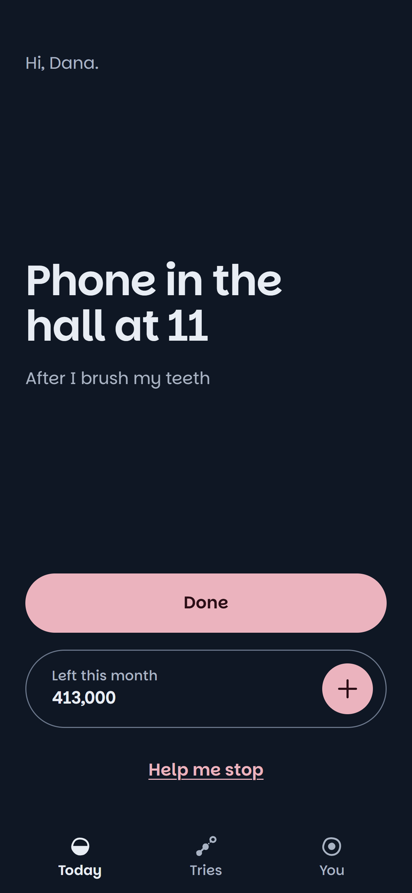
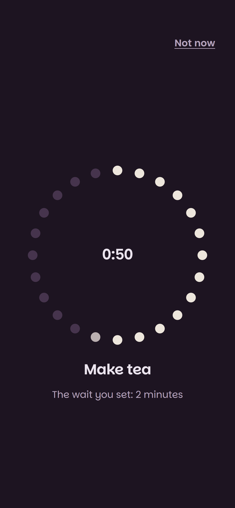
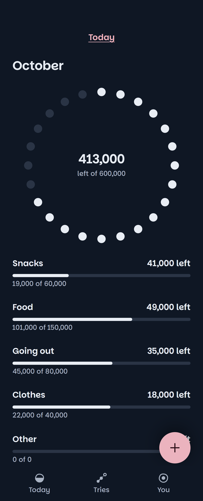
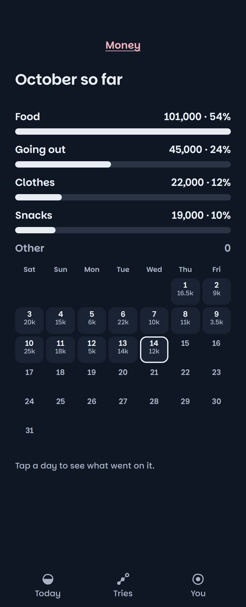

<!--
  Showcase README for the public repo arman-mahabad/tend-app.
  The code lives in a private repo. This repo holds only this page and its pictures.
-->

<a href="https://byarman.site">Made by Arman ↗</a>

# Tend

**A private habit app. You pick a goal and try one small change at a time. No streaks, no shame, no calorie targets.**

**Live** &nbsp;·&nbsp; For a small closed circle, on purpose &nbsp;·&nbsp; The code is private because it holds personal data. This page shows what it does and how it keeps that data safe.

The Today screen. Everything in these pictures is demo data, because the real app holds personal data.

## The hard parts

### Sync the server can't read

Tend keeps your data on your phone and syncs it to your other devices. I wanted the server to store that data without being able to read it. Each device encrypts with Web Crypto before anything leaves. A new device joins by scanning a QR code, a recovery key restores everything on a new phone, and when two devices disagree, the newest edit wins.

### Strong passwords on a free plan

Safe password hashing costs CPU time, and the free server plan can't pay it. So your device does the heavy work, 600,000 rounds of PBKDF2, and sends only the result. Passkeys work too.

### An AI that never repeats your words

Tend has one AI job. Once a week, if you opted in, a model reads what you chose to share and writes me 3 to 6 notes on what to change in the app. The notes talk about the app only, never about you.

Code throws away any note that shares four words in a row with anything you wrote. The model gets one more try. If it copies again, Tend saves nothing that week. Lower your sharing setting and Tend deletes your shared words and every note made from them.

The check catches word-for-word copying. A note that retells your words in new words would get past it, and only the prompt guards against that. I logged it as an accepted risk.

## Evidence first

Before building, I collected what research says helps people change a habit. The ledger holds 135 evidence rows from 142 sources, and I marked 20 of them "not supported". Separate checker agents verified each lead from chat tools before it went in.

## What you see

**Today.** The small changes you're trying, and what's next.

**Help me stop.** When an urge hits, a ring counts down a short wait with you.

The wait ring, set to a two-minute wait. Demo data.

**Money.** A month of what came in and went out, day by day.

&nbsp;&nbsp;

The month at a glance, and each day's spending. Demo data.

## Where it's going

The idea: each person gets an AI that works out their real problem, and a second AI learns from all of them and improves the app. One small piece of that exists today, the weekly notes above. The rest is a plan.

## In numbers

- **About 530** unit and server tests, plus **65** browser tests.
- **88** logged decisions, each with its reason.

## My part

I decided what it does, designed how it looks and reads, and directed the build.

**Model:** Llama 3.3 70B on Cloudflare Workers AI. I chose a provider that doesn't keep or train on what it reads.

**Built with:** `React` `TypeScript` `Vite` `Dexie` `PWA` `Cloudflare Workers` `Hono` `D1` `Web Push` `Passkeys` `Vitest` `Playwright`

## Not done yet

- It's open to a small closed circle on purpose. No usage numbers yet, so I give none.
- No scored test of note quality yet.

---

I can walk you through the code on a call: [arman@byarman.site](mailto:arman@byarman.site)

More of my work: [byarman.site](https://byarman.site) &nbsp;·&nbsp; [github.com/arman-mahabad](https://github.com/arman-mahabad)
